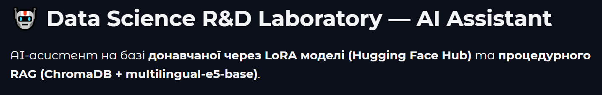
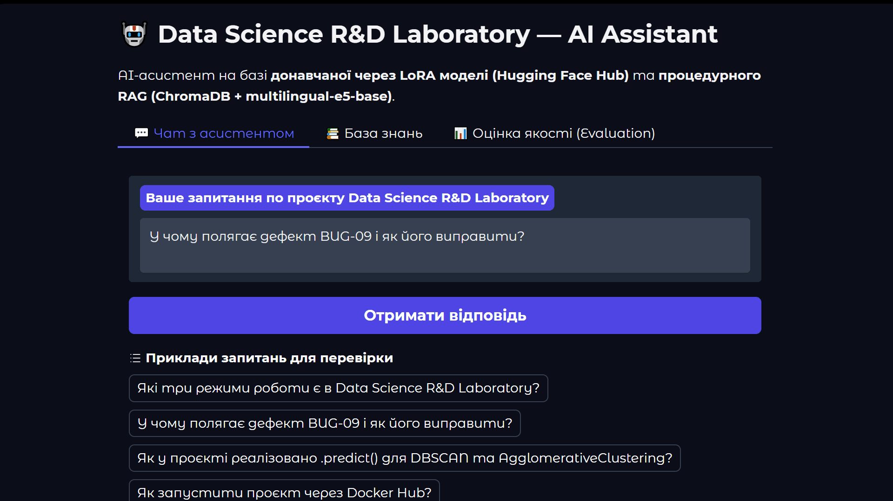
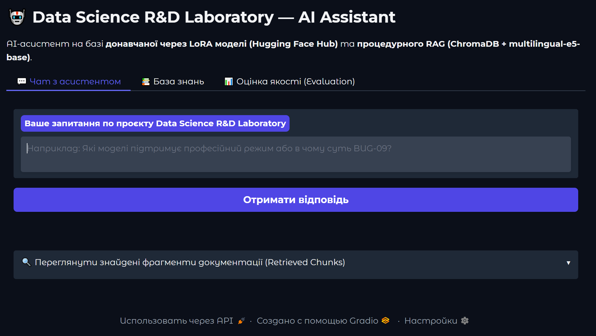
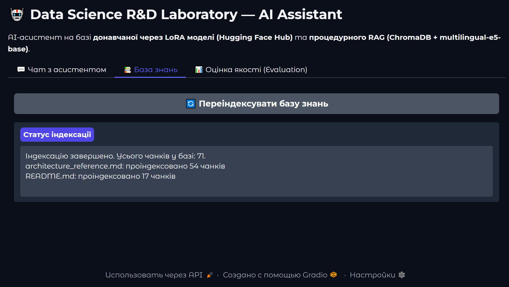
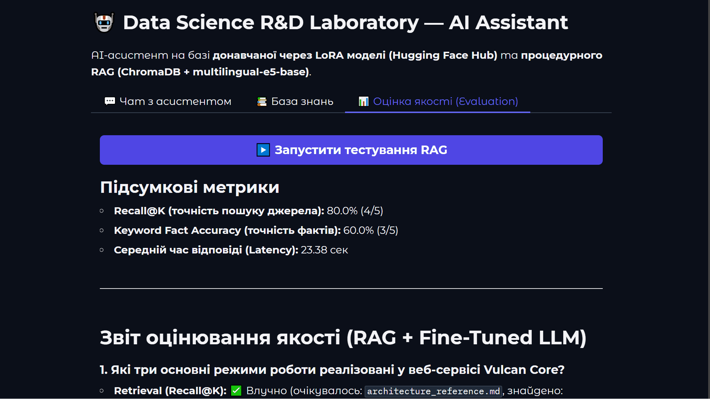
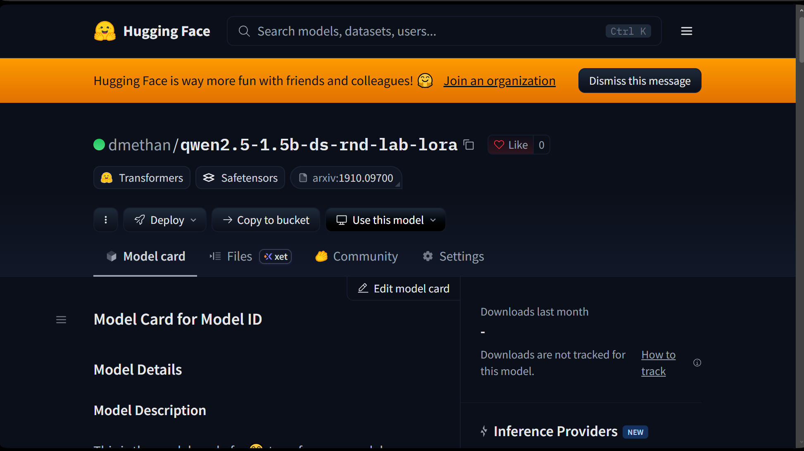

# 🤖 Data Science R&D Laboratory — Fine-Tuned RAG AI Assistant

[](https://huggingface.co/dmethan/qwen2.5-1.5b-ds-rnd-lab-lora)
[](https://huggingface.co/Qwen/Qwen2.5-1.5B-Instruct)
[](https://huggingface.co/docs/peft)
[](https://www.trychroma.com/)
[](https://www.gradio.app/)

AI-асистент для пошуку та пояснення інформації про веб-сервіс **Data Science Research and Development Laboratory (Vulcan Core)** на базі донавченої через **LoRA** моделі та процедурного **RAG** (`ChromaDB` + `intfloat/multilingual-e5-base`).



## Демонстрація режимів роботи

### 1. Чат з асистентом та перевірка джерел



### 2. Управління базою знань (ChromaDB)


### 3. Оцінка якості (Evaluation)


### Картка моделі на Hugging Face Hub


## Запуск першого проєкту

Перейдіть у директорію `01_finetuned_rag_assistant` та запустіть потрібний модуль (за умови активованого `.venv` з кореня репозиторію):

```powershell
    cd 01_finetuned_rag_assistant
```
```python
    python -m src.train_and_push
    python -m src.app
```