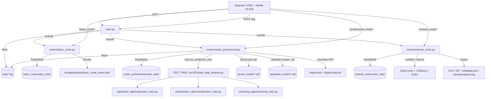
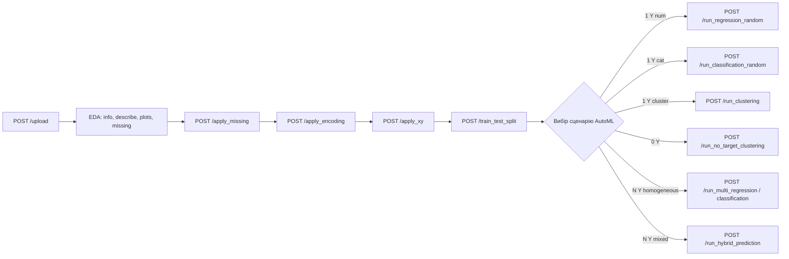

# Data Science Research and Development Laboratory (Vulcan Core) — AI Knowledge Graph & Machine Reference

> **Призначення документа:** Машинний довідник архітектури веб-сервісу, орієнтований на завантаження в контекст великих мовних моделей (LLM) для миттєвої навігації по проєкту без читання вихідного коду та економії токенів. Містить повну карту файлів, функцій, ендпоінтів, станів, граф знань у чотирьох взаємодублюючих форматах (`Mermaid`, `ASCII`, `YAML/JSON`, `Text Triplets`) та реєстр виявлених технічних дефектів.

---

## 1. Загальний паспорт системи

* **Назва продукту:** Data Science Research and Development Laboratory (кодова назва у UI — `Vulcan Core`).
* **Тип системи:** Клієнт-серверний No-Code / Low-Code веб-сервіс автоматизованого машинного навчання (AutoML) та інтерактивного аналізу табличних даних.
* **Архітектурний стиль:** Модульний моноліт на базі FastAPI із серверним рендерингом шаблонів (Jinja2) та асинхронною SPA-подібною взаємодією через Fetch API (Vanilla ES6 Modules).
* **Ключові режими роботи:**
  1. **Basic Mode (`/basic_mode`):** автоматичне визначення типу задачі (`regression`, `classification`, `clustering`), швидке навчання однієї моделі за замовчуванням та інференс на нових даних.
  2. **Professional Mode (`/professional_mode`):** вибір конкретного алгоритму з пакета `TEST_PROF_ALGRS` (18 моделей), ручне налаштування гіперпараметрів, збереження/завантаження артефактів `.pkl`, порівняння моделей, експорт PDF-звітів, перегляд логів.
  3. **Manual & AutoML Mode (`/manual_mode`):** покроковий інженерний пайплайн (EDA, обробка пропусків, кодування/масштабування, журнал трансформацій, вибір $X$ та $Y$, розбиття `train/val/test`, AutoML-пошук гіперпараметрів через `RandomizedSearchCV`, підтримка багатовихідних (`MultiOutput`) та гібридних задач).

---

## 2. Ієрархія файлів та директорій проєкту

```text
project_root/
├── main.py                                      # Точка входу FastAPI, підключення роутерів, /log, /
├── logging_config.py                            # Налаштування ротаційних логерів (app_info, app_debug, js_info, js_debug)
├── routers/
│   ├── basic_router.py                          # Маршрути та ML-логіка звичайного режиму (/basic_mode)
│   ├── router_professional.py                   # Маршрути професійного режиму (/professional_mode), PDF-звіти, порівняння, логи
│   └── manual_router.py                         # Маршрути ручного та AutoML режиму (/manual_mode)
├── TEST_PROF_ALGRS/                             # Ядро ML-алгоритмів для професійного режиму
│   ├── start_task_detector.py                   # Диспетчер викликів run_prediction_task()
│   ├── regression_algs/
│   │   ├── regression_main.py                   # Маршрутизатор моделей регресії
│   │   ├── utils/
│   │   │   ├── preprocessing.py                 # Підготовка даних, train_test_split, OneHotEncoder/StandardScaler
│   │   │   ├── metrics.py                       # Розрахунок R2, MAE, MSE, RMSE, MAPE, Explained Variance
│   │   │   ├── visualization.py                 # Генерація base64-графіків (actual vs pred, residuals, Q-Q, feature importance)
│   │   │   └── model_io.py                      # Збереження/завантаження .pkl у saved_models/
│   │   └── models/
│   │       ├── linear_regression_model.py       # LinearRegression
│   │       ├── random_forest_model.py           # RandomForestRegressor
│   │       ├── gradient_boosting_model.py       # GradientBoostingRegressor
│   │       └── xgboost_model.py                 # XGBRegressor
│   ├── classification_algs/
│   │   ├── classification_main.py               # Маршрутизатор моделей класифікації
│   │   ├── utils/
│   │   │   ├── preprocessing.py                 # Підготовка даних, LabelEncoder для Y, ColumnTransformer для X
│   │   │   ├── metrics.py                       # Accuracy, Precision, Recall, F1, ROC-AUC, LogLoss, MCC, Kappa
│   │   │   ├── visualization.py                 # Confusion Matrix, ROC, PR-криві, Feature Importance
│   │   │   └── model_io.py                      # Збереження/завантаження .pkl
│   │   └── models/
│   │       ├── logistic_regression_model.py     # LogisticRegression
│   │       ├── decision_tree_model.py           # DecisionTreeClassifier
│   │       ├── random_forest_model.py           # RandomForestClassifier
│   │       ├── gradient_boosting_model.py       # GradientBoostingClassifier
│   │       ├── xgboost_model.py                 # XGBClassifier
│   │       ├── svm_model.py                     # SVC(probability=True)
│   │       └── knn_model.py                     # KNeighborsClassifier
│   └── clustering_algs/
│       ├── clustering_main.py                   # Маршрутизатор кластеризації + обгортка KNN для трансдуктивних моделей
│       ├── utils/
│       │   ├── preprocessing.py                 # Семплінг (max_rows=10000), імпутація, StandardScaler
│       │   ├── metrics.py                       # Silhouette, Calinski-Harabasz, Davies-Bouldin, ARI, NMI, Homogeneity
│       │   ├── visualization.py                 # PCA 2D scatter, розподіл кластерів, графік силуетів
│       │   └── model_io.py                      # Збереження/завантаження .pkl
│       └── models/
│           ├── kmeans_model.py                  # KMeans
│           ├── dbscan_model.py                  # DBSCAN
│           ├── gmm_model.py                     # GaussianMixture
│           ├── optics_model.py                  # OPTICS
│           ├── mean_shift_model.py              # MeanShift + estimate_bandwidth
│           ├── spectral_model.py                # SpectralClustering
│           └── agglomerative_model.py           # AgglomerativeClustering
├── templates/
│   ├── main_index.html                          # Головна сторінка вибору режиму (Лоббі)
│   ├── basic/
│   │   ├── basic_mode_index.html                # Головна сторінка Basic Mode
│   │   └── components/
│   │       ├── upload_csv.html                  # Форма завантаження CSV (/basic_mode/upload)
│   │       ├── table_select.html                # Таблиця прев'ю з вибором цільової колонки
│   │       └── input_predict.html               # Форма введення ознак для прогнозу
│   └── professional/
│       ├── professional_mode_index.html         # Головна сторінка Professional Mode
│       ├── manual_mode_index.html               # Головна сторінка Manual / AutoML Mode
│       ├── compare_model.html                   # Сторінка порівняння до 4 моделей (.pkl)
│       ├── logs.html                            # Сторінка перегляду та фільтрації логів
│       └── components/
│           ├── upload_csv.html                  # Форма завантаження CSV (/manual_mode/upload)
│           ├── table_select.html                # Таблиця прев'ю перших рядків датасету
│           ├── input_predict.html               # Форма інференсу для професійного режиму
│           └── plots_section.html               # Секція відображення base64-графіків
├── static/
│   ├── home_page_js_script.js                   # Навігація з лоббі (/basic_mode, /professional_mode, /manual_mode)
│   ├── basic_js_script.js                       # Клієнтська логіка Basic Mode
│   ├── professional_js_script.js                # Клієнтська логіка Professional Mode + словник PARAMS_CONFIG
│   ├── manual_js_script.js                      # Клієнтська логіка Manual / AutoML Mode
│   ├── compare_models_script.js                 # Логіка завантаження та рендеру карток порівняння моделей
│   ├── logs_js_script.js                        # Пагінація, пошук та фільтрація логів
│   ├── logger.js                                # Клієнтський транспорт логів у POST /log
│   └── *.css, favicon.svg                       # Таблиці стилів та іконка
├── saved_models/                                # Директорія збережених серіалізованих моделей (.pkl)
├── uploaded_models/                             # Директорія моделей, завантажених для порівняння (.pkl)
├── fonts/DejaVuSans.ttf                         # Кириличний шрифт для генерації PDF-звітів (ReportLab)
└── logs/                                        # Журнали подій (app_info.log, app_debug.log, js_info.log, js_debug.log)
```

---

## 3. Повний реєстр модулів, функцій та HTTP-ендпоінтів

### 3.1. Ядро застосунку (`main.py`, `logging_config.py`)
* `main.py`:
  * Ініціалізує екземпляр `FastAPI`, монтує `/static`, підключає `basic_router`, `router_professional`, `manual_router`.
  * `GET /` $\rightarrow$ повертає `templates/main_index.html`.
  * `POST /log` $\rightarrow$ приймає `{level, message}` від `static/logger.js` і записує у `js_info.log` або `js_debug.log`.
* `logging_config.py`:
  * Конфігурує роздільне логування бекенду (`logger`) та фронтенду (`js_logger`) у директорію `logs/`.

### 3.2. Звичайний режим (`routers/basic_router.py`, префікс `/basic_mode`)
* **Стан модуля:** глобальний словник `basic_state` (`dataframe`, `model`, `task_type`, `target_column`, `feature_columns`, `scaler`, `encoders`).
* **Функції та маршрути:**
  * `GET /basic_mode/` $\rightarrow$ рендерить `basic/basic_mode_index.html`.
  * `POST /basic_mode/upload` $\rightarrow$ читає CSV у `pd.DataFrame`, зберігає в `basic_state["dataframe"]`, повертає перші рядки та `dtypes` у шаблон.
  * `detect_task_type(df, target)` $\rightarrow$ визначає тип задачі: якщо `target is None` $\rightarrow$ `"clustering"`; якщо нечисловий тип або кількість унікальних значень $\le 10$ $\rightarrow$ `"classification"`; інакше $\rightarrow$ `"regression"`.
  * `POST /basic_mode/train` $\rightarrow$ приймає `{target?: str}`, виконує базову імпутацію/кодування, тренує дефолтну модель (`RandomForestRegressor`, `RandomForestClassifier` або `KMeans`), зберігає її в `basic_state`, повертає `{task, features, metric_name, metric_value}`.
  * `POST /basic_mode/predict-value` $\rightarrow$ приймає `{values: dict}`, трансформує ознаки, повертає `{prediction, probabilities?, cluster_size?, cluster_centroid?}`.

### 3.3. Професійний режим (`routers/router_professional.py` + `TEST_PROF_ALGRS/`)
* **Стан модуля (`router_professional.py`):** локальні словники `basic_state` (`dataframe`, `model`, `task_type`, `target_column`, `feature_columns`) та `dataset_info` (`dataset_name`, `columns`, `dtypes`).
* **Маршрути `router_professional.py` (префікс `/professional_mode`):**
  * `GET /professional_mode/` $\rightarrow$ рендерить `professional/professional_mode_index.html`.
  * `POST /professional_mode/upload` $\rightarrow$ завантажує CSV, оновлює `basic_state["dataframe"]` і `dataset_info`, рендерить прев'ю (10 рядків).
  * `POST /professional_mode/detect_task` $\rightarrow$ приймає `{target}`, викликає `detect_task_type(df, target)`, повертає `{task_type}`.
  * `POST /professional_mode/train` $\rightarrow$ приймає `{model_name, params, task_type, target}`, нормалізує параметри через `normalize_params()`, викликає `TEST_PROF_ALGRS.start_task_detector.run_prediction_task(...)`, зберігає модель із метаданими у `saved_models/{model_name}.pkl`, повертає JSON (`message`, `model_name`, `task_type`, `target_column`, `params`, `features`, `metrics`, `plots`, `input_template`).
  * `GET /professional_mode/download_model/{filename}` $\rightarrow$ віддає `.pkl` файл із `saved_models/` через `FileResponse`.
  * `GET /professional_mode/compare_models` $\rightarrow$ рендерить `professional/compare_model.html`.
  * `POST /professional_mode/upload_model` $\rightarrow$ приймає `.pkl` файл, зберігає у `uploaded_models/`, десеріалізує через `pickle.load` і повертає `{filename, metadata}`.
  * `POST /professional_mode/predict` $\rightarrow$ завантажує `saved_models/{model_name}.pkl`, приводить значення `input_data` до `float`, формує `DataFrame` за `metadata["features"]`, виконує `predict()` (або `fit_predict()`), повертає прогноз, кроки пайплайну, версії бібліотек і час виконання.
  * `POST /professional_mode/generate_report` $\rightarrow$ формує PDF-звіт у пам'яті (`io.BytesIO`) за допомогою `reportlab` зі шрифтом `DejaVuSans.ttf` (титульна сторінка, схема датасету, метрики, параметри, графіки base64, кроки пайплайну, версії середовища) і віддає як `StreamingResponse`.
  * `GET /professional_mode/logs` та `GET /professional_mode/logs_page` $\rightarrow$ читає рядки з `logs/{type}.log` та рендерить `professional/logs.html`.
* **Диспетчер `TEST_PROF_ALGRS/start_task_detector.py`:**
  * `run_prediction_task(df, target_column, task_type, model_name, params)` $\rightarrow$ делегує виконання у `run_regression()`, `run_classification()` або `run_clustering()`.
  * **Моделі регресії (`regression_algs`):** `linear_regression`, `random_forest`, `gradient_boosting`, `xgboost`.
  * **Моделі класифікації (`classification_algs`):** `logistic_regression`, `decision_tree`, `random_forest`, `gradient_boosting`, `xgboost`, `svm`, `knn`.
  * **Моделі кластеризації (`clustering_algs`):** `kmeans`, `dbscan`, `gmm`, `optics` (+ сурогатний `KNeighborsClassifier`), `mean_shift`, `spectral` (+ сурогатний `KNN`), `agglomerative` (+ сурогатний `KNN`).

### 3.4. Ручний режим та AutoML (`routers/manual_router.py`, префікс `/manual_mode`)
* **Стан модуля:** `basic_state` (`dataframe`, `model`, `task_type`, `target_column`, `feature_columns`, `transformations`, `X`, `Y`, `x_train`, `x_val`, `x_test`, `y_train`, `y_val`, `y_test`) та `dataset_info`.
* **Маршрути та функції:**
  * `GET /manual_mode/` $\rightarrow$ рендерить `professional/manual_mode_index.html`.
  * `POST /manual_mode/upload` $\rightarrow$ обчислює пропуски, `df.info()`, `df.describe()`, будує гістограми/bar-чарти та кореляційну теплову карту, формує `encoding_table`, рендерить шаблон.
  * `GET /manual_mode/analysis/plot` $\rightarrow$ параметри `column`, `type` (`histogram`, `boxplot`, `heatmap`), повертає `{img: base64}`.
  * `POST /manual_mode/apply_missing` $\rightarrow$ застосовує `drop`, `unknown`, `mean`, `median`, `mode` по колонках, логує в `transformations`.
  * `POST /manual_mode/apply_encoding` $\rightarrow$ застосовує `normalization`, `standard_scaler`, `one_hot`, `label`, `year`, `month`, `day`, `timestamp`, `days_diff`.
  * `GET /manual_mode/get_columns`, `GET /manual_mode/correlation_matrix`, `POST /manual_mode/correlation_selected` $\rightarrow$ кореляційний аналіз.
  * `POST /manual_mode/apply_xy`, `GET /manual_mode/get_y_info` $\rightarrow$ фіксація списків ознак `X` та цільових змінних `Y`.
  * `POST /manual_mode/train_test_split` $\rightarrow$ поділ вибірки на `train`, `val`, `test`.
  * `GET /manual_mode/download_split/{part}`, `/download_split_zip`, `/download_full_dataset`, `/download_xy_zip` $\rightarrow$ експорт вибірок у CSV та ZIP.
  * `GET /manual_mode/transformations`, `/save_transformations_log`, `/export_metadata_json` $\rightarrow$ перегляд та експорт журналу трансформацій.
  * `POST /manual_mode/start_task` $\rightarrow$ фіксація типу задачі.
  * `POST /manual_mode/run_regression_random` $\rightarrow$ викликає `run_regression_models_random()` (`LinearRegression`, `RandomForestRegressor`, `GradientBoostingRegressor`, `XGBRegressor` + `RandomizedSearchCV`, топ-3 за $R^2$).
  * `POST /manual_mode/run_classification_random` $\rightarrow$ викликає `run_classification_models_random()` (`LogisticRegression`, `DecisionTreeClassifier`, `RandomForestClassifier`, `SVC` + `RandomizedSearchCV`, топ-3 за Accuracy).
  * `POST /manual_mode/run_clustering` $\rightarrow$ викликає `run_clustering_models()` (`KMeans`, `DBSCAN`, `SpectralClustering`, `GaussianMixture` з порівнянням із `Y`).
  * `POST /manual_mode/run_no_target_clustering` $\rightarrow$ викликає `run_no_target_clustering()` (підбір $k$ методом ліктя для `KMeans` + 4 кластеризатори).
  * `POST /manual_mode/run_multi_regression` $\rightarrow$ викликає `run_multi_regression()` (`MultiOutputRegressor` для RF та GB).
  * `POST /manual_mode/run_multi_classification` $\rightarrow$ викликає `run_multi_classification()` (`MultiOutputClassifier` для RF, GB, LogisticRegression).
  * `GET /manual_mode/get_target_features_for_hybrid`, `POST /manual_mode/run_hybrid_prediction` $\rightarrow$ роздільне навчання класифікаторів для `categorical_targets` і регресорів для `numeric_targets`.

---

## 4. Граф знань проєкту (4 взаємодублюючі формати)

### 4.1. Варіант 1: Mermaid-діаграми

#### А. Архітектура модулів та потоків запитів


#### Б. Послідовність даних у Manual / AutoML Mode


---

### 4.2. Варіант 2: ASCII-дерево зв'язків та викликів

```text
[VULCAN CORE SYSTEM]
 │
 ├──► [FRONTEND LAYER]
 │     ├── templates/main_index.html ──► static/home_page_js_script.js ──► {/basic_mode, /professional_mode, /manual_mode}
 │     ├── templates/basic/basic_mode_index.html ──► static/basic_js_script.js
 │     │     ├── selectColumn() ──► UI update
 │     │     ├── trainModel() / trainModelNoTarget() ──► POST /basic_mode/train
 │     │     └── predict() ──► POST /basic_mode/predict-value
 │     ├── templates/professional/professional_mode_index.html ──► static/professional_js_script.js
 │     │     ├── determineTask() ──► POST /professional_mode/detect_task
 │     │     ├── showParams() ──► PARAMS_CONFIG lookup
 │     │     ├── trainModel() ──► POST /professional_mode/train
 │     │     ├── downloadModel() ──► GET /professional_mode/download_model/{filename}
 │     │     ├── predict() ──► POST /professional_mode/predict
 │     │     └── generateReport() ──► POST /professional_mode/generate_report
 │     ├── templates/professional/compare_model.html ──► static/compare_models_script.js ──► POST /professional_mode/upload_model
 │     ├── templates/professional/logs.html ──► static/logs_js_script.js ──► GET /professional_mode/logs
 │     └── templates/professional/manual_mode_index.html ──► static/manual_js_script.js
 │           ├── generatePlot() ──► GET /manual_mode/analysis/plot
 │           ├── applyMissingMethods() ──► POST /manual_mode/apply_missing
 │           ├── applyEncodingMethods() ──► POST /manual_mode/apply_encoding
 │           ├── generateCorrelationMatrix() / generateSelectedCorrelation() ──► GET /correlation_matrix, POST /correlation_selected
 │           ├── applyXYSelection() ──► POST /manual_mode/apply_xy
 │           ├── applyTrainTestSplit() ──► POST /manual_mode/train_test_split
 │           ├── refreshTransformations() ──► GET /manual_mode/transformations
 │           ├── loadTaskButtons() ──► GET /manual_mode/get_y_info
 │           └── run*Models() ──► POST /manual_mode/run_{regression_random|classification_random|clustering|no_target_clustering|multi_regression|multi_classification|hybrid_prediction}
 │
 └──► [BACKEND LAYER]
       ├── main.py ──► FastAPI app + POST /log ──► logging_config.py
       ├── routers/basic_router.py ──► in-memory basic_state ──► sklearn (RF / KMeans)
       ├── routers/router_professional.py ──► TEST_PROF_ALGRS/start_task_detector.py
       │     ├── regression_main.py ──► {linear_regression, random_forest, gradient_boosting, xgboost}
       │     ├── classification_main.py ──► {logistic_regression, decision_tree, random_forest, gradient_boosting, xgboost, svm, knn}
       │     └── clustering_main.py ──► {kmeans, dbscan, gmm, optics+KNN, mean_shift, spectral+KNN, agglomerative+KNN}
       └── routers/manual_router.py ──► in-memory basic_state + log_transformation() ──► RandomizedSearchCV / MultiOutput / Hybrid
```

---

### 4.3. Варіант 3: Структурований YAML / JSON граф знань

```yaml
system:
  name: "Data Science Research and Development Laboratory"
  alias: "Vulcan Core"
  framework: "FastAPI"
  state_architecture: "In-Memory Global Dictionaries per Router Module"

nodes:
  - id: "main_app"
    file: "main.py"
    endpoints:
      - { method: "GET", path: "/", renders: "templates/main_index.html" }
      - { method: "POST", path: "/log", writes_to: ["logs/js_info.log", "logs/js_debug.log"] }

  - id: "basic_mode"
    file: "routers/basic_router.py"
    prefix: "/basic_mode"
    frontend_js: "static/basic_js_script.js"
    frontend_html: "templates/basic/basic_mode_index.html"
    state_keys: ["dataframe", "model", "task_type", "target_column", "feature_columns", "scaler", "encoders"]
    endpoints:
      - { method: "GET", path: "/", func: "basic_home_page" }
      - { method: "POST", path: "/upload", func: "upload_csv" }
      - { method: "POST", path: "/train", func: "train_model" }
      - { method: "POST", path: "/predict-value", func: "predict_value" }

  - id: "professional_mode"
    file: "routers/router_professional.py"
    prefix: "/professional_mode"
    frontend_js: ["static/professional_js_script.js", "static/compare_models_script.js", "static/logs_js_script.js"]
    frontend_html: ["templates/professional/professional_mode_index.html", "templates/professional/compare_model.html", "templates/professional/logs.html"]
    delegates_to: "TEST_PROF_ALGRS/start_task_detector.py::run_prediction_task"
    storage: ["saved_models/*.pkl", "uploaded_models/*.pkl"]
    endpoints:
      - { method: "GET", path: "/", func: "professional_home_page" }
      - { method: "POST", path: "/upload", func: "upload_csv" }
      - { method: "POST", path: "/detect_task", func: "detect_task" }
      - { method: "POST", path: "/train", func: "train_model" }
      - { method: "GET", path: "/download_model/{filename}", func: "download_model" }
      - { method: "GET", path: "/compare_models", func: "compare_models_page" }
      - { method: "POST", path: "/upload_model", func: "upload_model" }
      - { method: "POST", path: "/predict", func: "predict" }
      - { method: "POST", path: "/generate_report", func: "generate_report" }
      - { method: "GET", path: "/logs", func: "get_logs" }
      - { method: "GET", path: "/logs_page", func: "logs_page" }

  - id: "manual_automl_mode"
    file: "routers/manual_router.py"
    prefix: "/manual_mode"
    frontend_js: "static/manual_js_script.js"
    frontend_html: "templates/professional/manual_mode_index.html"
    state_keys: ["dataframe", "model", "task_type", "target_column", "feature_columns", "transformations", "X", "Y", "x_train", "x_val", "x_test", "y_train", "y_val", "y_test"]
    endpoints:
      - { method: "GET", path: "/", func: "professional_home_page" }
      - { method: "POST", path: "/upload", func: "upload_csv" }
      - { method: "GET", path: "/analysis/plot", func: "analysis_plot" }
      - { method: "POST", path: "/apply_missing", func: "apply_missing" }
      - { method: "POST", path: "/apply_encoding", func: "apply_encoding" }
      - { method: "GET", path: "/get_columns", func: "get_columns" }
      - { method: "GET", path: "/correlation_matrix", func: "correlation_matrix" }
      - { method: "POST", path: "/correlation_selected", func: "correlation_selected" }
      - { method: "POST", path: "/apply_xy", func: "apply_xy" }
      - { method: "POST", path: "/train_test_split", func: "train_test_split_endpoint" }
      - { method: "GET", path: "/download_split/{part}", func: "download_split" }
      - { method: "GET", path: "/download_split_zip", func: "download_split_zip" }
      - { method: "GET", path: "/download_full_dataset", func: "download_full_dataset" }
      - { method: "GET", path: "/download_xy_zip", func: "download_xy_zip" }
      - { method: "GET", path: "/get_y_info", func: "get_y_info" }
      - { method: "POST", path: "/start_task", func: "start_task" }
      - { method: "GET", path: "/transformations", func: "get_transformations" }
      - { method: "GET", path: "/save_transformations_log", func: "save_transformations_log" }
      - { method: "GET", path: "/export_metadata_json", func: "export_metadata_json" }
      - { method: "POST", path: "/run_regression_random", func: "run_regression_random_endpoint" }
      - { method: "POST", path: "/run_classification_random", func: "run_classification_random_endpoint" }
      - { method: "POST", path: "/run_clustering", func: "run_clustering_endpoint" }
      - { method: "POST", path: "/run_no_target_clustering", func: "run_no_target_clustering_endpoint" }
      - { method: "POST", path: "/run_multi_regression", func: "run_multi_regression_endpoint" }
      - { method: "POST", path: "/run_multi_classification", func: "run_multi_classification_endpoint" }
      - { method: "GET", path: "/get_target_features_for_hybrid", func: "get_target_features" }
      - { method: "POST", path: "/run_hybrid_prediction", func: "run_hybrid_prediction_endpoint" }

edges:
  - { from: "static/logger.js", to: "main.py::/log", relation: "HTTP_POST_ASYNC" }
  - { from: "routers/router_professional.py::train_model", to: "TEST_PROF_ALGRS/start_task_detector.py::run_prediction_task", relation: "PYTHON_CALL" }
  - { from: "TEST_PROF_ALGRS/clustering_algs/clustering_main.py", to: "sklearn.neighbors.KNeighborsClassifier", relation: "SURROGATE_PREDICTOR_FOR_TRANSDUCTIVE_CLUSTERING" }
  - { from: "routers/router_professional.py::generate_report", to: "fonts/DejaVuSans.ttf", relation: "PDF_FONT_DEPENDENCY" }
```

---

### 4.4. Варіант 4: Текстовий лінійний запис графу (Semantic Triplets)

1. `main.py` $\rightarrow$ `[MOUNT]` $\rightarrow$ `/static` та підключає роутери `basic_router`, `router_professional`, `manual_router`.
2. `templates/main_index.html` $\rightarrow$ `[LOADS]` $\rightarrow$ `static/home_page_js_script.js`, який перенаправляє користувача на `/basic_mode`, `/professional_mode` або `/manual_mode`.
3. `static/logger.js` $\rightarrow$ `[SENDS_LOGS]` $\rightarrow$ `POST /log` у `main.py`, який записує клієнтські події у `logs/js_info.log` та `logs/js_debug.log`.
4. `routers/basic_router.py` $\rightarrow$ `[STORES_STATE_IN]` $\rightarrow$ модульний словник `basic_state` та тренує моделі без збереження файлів на диск.
5. `templates/professional/professional_mode_index.html` $\rightarrow$ `[INCLUDES]` $\rightarrow$ `templates/professional/components/table_select.html` та `[LOADS]` $\rightarrow$ `static/professional_js_script.js`.
6. `static/professional_js_script.js` $\rightarrow$ `[CALLS]` $\rightarrow$ `POST /professional_mode/detect_task`, `POST /professional_mode/train`, `GET /professional_mode/download_model/{filename}`, `POST /professional_mode/predict`, `POST /professional_mode/generate_report`.
7. `routers/router_professional.py::train_model` $\rightarrow$ `[CALLS]` $\rightarrow$ `TEST_PROF_ALGRS/start_task_detector.py::run_prediction_task`.
8. `TEST_PROF_ALGRS/start_task_detector.py` $\rightarrow$ `[ROUTES_TO]` $\rightarrow$ `regression_main.py` (4 алгоритми), `classification_main.py` (7 алгоритмів) або `clustering_main.py` (7 алгоритмів).
9. `TEST_PROF_ALGRS/clustering_algs/clustering_main.py` $\rightarrow$ `[WRAPS]` $\rightarrow$ трансдуктивні моделі (`OPTICS`, `SpectralClustering`, `AgglomerativeClustering`) у сурогатний `KNeighborsClassifier(n_neighbors=5)` для підтримки `.predict()`.
10. `routers/router_professional.py::train_model` $\rightarrow$ `[SERIALIZES_PKL]` $\rightarrow$ `saved_models/{model_name}.pkl` (словник із ключами `model`, `metadata`).
11. `templates/professional/compare_model.html` $\rightarrow$ `[LOADS]` $\rightarrow$ `static/compare_models_script.js` $\rightarrow$ `[POSTS_PKL]` $\rightarrow$ `POST /professional_mode/upload_model` $\rightarrow$ `uploaded_models/`.
12. `templates/professional/logs.html` $\rightarrow$ `[LOADS]` $\rightarrow$ `static/logs_js_script.js` $\rightarrow$ `[FETCHES]` $\rightarrow$ `GET /professional_mode/logs?type=...`.
13. `templates/professional/manual_mode_index.html` $\rightarrow$ `[LOADS]` $\rightarrow$ `static/manual_js_script.js` $\rightarrow$ `[ORCHESTRATES]` $\rightarrow$ 27 ендпоінтів `/manual_mode/*`.
14. `routers/manual_router.py` $\rightarrow$ `[LOGS_HISTORY_IN]` $\rightarrow$ `basic_state["transformations"]` через функцію `log_transformation(action, column, method)`.
15. `routers/manual_router.py` $\rightarrow$ `[EXECUTES_AUTOML]` $\rightarrow$ `run_regression_models_random`, `run_classification_models_random`, `run_clustering_models`, `run_no_target_clustering`, `run_multi_regression`, `run_multi_classification`, `run_hybrid_prediction`.

---

## 5. Реєстр виявлених недоліків, помилок та способів їх усунення

| ID | Модуль / Файл | Опис проблеми (Root Cause) | Наслідки у рантаймі | Спосіб виправлення |
| :--- | :--- | :--- | :--- | :--- |
| **BUG-01** | `templates/professional/components/table_select.html` + `professional_mode_index.html` | Компонент `table_select.html` перезаписано під `manual_mode`: відсутні `onclick="selectColumn(this, ...)"` на `<th>`, кнопки `#determine-task-btn`, блоки `#task-selection`, `#model-selection`, `#params-block`. | У `professional_mode` неможливо обрати цільову колонку та запустити навчання; JS кидає `TypeError: Cannot set properties of null`. | Розділити компоненти на `professional/components/prof_table_select.html` (інтерактивний) та `manual_table_preview.html` (тільки прев'ю). |
| **BUG-02** | `static/professional_js_script.js` | У `PARAMS_CONFIG` ключі класифікації мають суфікс `_cls` (`random_forest_cls`, `gradient_boosting_cls`, `xgboost_cls`), а `selectTask('classification')` викликає `showParams('random_forest')` тощо. | Для класифікації підвантажуються параметри регресії (зокрема `objective: reg:squarederror` для XGBoost), а `*_cls` недосяжні. | У `selectTask('classification')` передавати ключі з суфіксом `_cls` у `showParams()`, або мапити ім'я моделі на бекенді. |
| **BUG-03** | `templates/professional/manual_mode_index.html` + `static/manual_js_script.js` | Обидві таблиці («Обробка пропусків» та «Кодування та масштабування») мають `<select name="method_{{ row.column }}">`. JS вибирає `querySelectorAll("select[name^='method_']")`. | Друга форма перезаписує значення першої; невалідні методи передаються в `/apply_missing` або `/apply_encoding`. | Використовувати унікальні префікси `missing_method_{{ row.column }}` та `encoding_method_{{ row.column }}` і фільтрувати лише непорожні (`sel.value !== ""`). |
| **BUG-04** | `static/manual_js_script.js` + `routers/manual_router.py` | У `manual_js_script.js` визначено `generateReport()` із запитом на `POST /manual_mode/generate_report`, але цього маршруту немає в `manual_router.py`. | Запит повертає `404 Not Found`. | Додати ендпоінт `/generate_report` у `manual_router.py` або винести генерацію PDF у спільний сервісний модуль. |
| **BUG-05** | `TEST_PROF_ALGRS/clustering_algs/*/train()` + `router_professional.py::predict` | `preprocess_data` масштабує дані через локальний `StandardScaler`, але не зберігає `scaler` у `.pkl`. Під час `/predict` вхідні дані передаються без масштабування. | Хибне віднесення точок до кластерів під час інференсу через невідповідність масштабів ознак. | Повертати `scaler` з `preprocess_data()` і зберігати його всередині `metadata` або об'єкта `sklearn.pipeline.Pipeline` у `.pkl`. |
| **BUG-06** | `TEST_PROF_ALGRS/clustering_algs/models/mean_shift_model.py` | `estimate_bandwidth(df, quantile=0.2)` викликається до `preprocess_data` на сирому `df` (де є текст або `NaN`), а тренування йде на масштабованому `X_scaled_df`. | Падіння `TypeError`/`ValueError` на датасетах із категоріальними колонками чи пропусками, або некоректний `bandwidth`. | Викликати `estimate_bandwidth(X_scaled_df)` після `preprocess_data()`. |
| **BUG-07** | `TEST_PROF_ALGRS/clustering_algs/models/*.py` | При `len(df) > 10000` `preprocess_data` робить випадковий `.sample(10000)`, але моделі беруть `df.iloc[:len(labels)]` (перші 10 000 рядків сирого `df`). | Зміщення індексів при обчисленні центроїдів кластерів та падіння на `NaN` у сирому `df`. | Повертати з `preprocess_data()` синхронізований зріз `df_sampled` та використовувати його для групування. |
| **BUG-08** | `routers/router_professional.py::predict` | Примусова конвертація всіх вхідних полів `{k: float(v) for k, v in input_data.items()}` і відсутність виклику `prepare_user_input`. | Неможливість інференсу для моделей, навчених на категоріальних (рядкових) ознаках. | Використовувати `prepare_user_input(input_data, metadata)` з утиліт або серіалізувати повний `ColumnTransformer`/`Pipeline`. |
| **BUG-09** | `routers/manual_router.py::apply_encoding` | Масштабування (`normalization`, `standard_scaler`) та `one_hot` виконуються до `train_test_split` на всьому датасеті. | Витік даних (Data Leakage) із тестової та валідаційної вибірок у навчальну. | Застосовувати `fit` скейлерів/енкодерів виключно на `X_train`, а до `X_val` і `X_test` застосовувати лише `transform`. |
| **BUG-10** | `routers/manual_router.py::run_classification_models_random` | Передано `n_iter=min(n_iter, len(param_dist))`, де `len(param_dist)` — кількість гіперпараметрів (2–3), а не розмір простору пошуку. | `RandomizedSearchCV` робить лише 2–3 ітерації замість заданих 30. | Передавати фіксоване `n_iter` або обчислювати добуток довжин списків параметрів у `param_dist`. |
| **BUG-11** | `routers/manual_router.py::run_clustering_models` | Для `DBSCAN` і `SpectralClustering` на `X_val` та `X_test` викликається `model.fit_predict(...)`. | Моделі перенавчаються заново на малих вибірках з іншими індексами кластерів, що робить порівняння з `Y_val`/`Y_test` некоректним. | Використовувати сурогатний класифікатор (наприклад, `KNN`), навчений на `(X_train, clusters_train)`, як це зроблено у `TEST_PROF_ALGRS`. |
| **BUG-12** | `routers/router_professional.py` та `routers/manual_router.py` | 1) Глобальні словники `basic_state` у пам'яті процесу; 2) Небезпечна десеріалізація `pickle.load` в `/upload_model`; 3) Відсутність валідації шляху в `/download_model/{filename}`; 4) Тимчасові CSV/JSON/LOG у корені проєкту. | 1) Перезапис даних при одночасній роботі кількох користувачів; 2) Вразливість RCE через шкідливий `.pkl`; 3) Ризик Path Traversal; 4) Засмічення робочої директорії. | 1) Впровадити сесійне сховище за `session_id` (Redis / тимчасові директорії сесій); 2) Використовувати `skops.io` або верифікацію підпису артефактів; 3) Фільтрувати імена через `os.path.basename()`; 4) Використовувати `tempfile` або `BackgroundTasks` для видалення файлів після відповіді. |