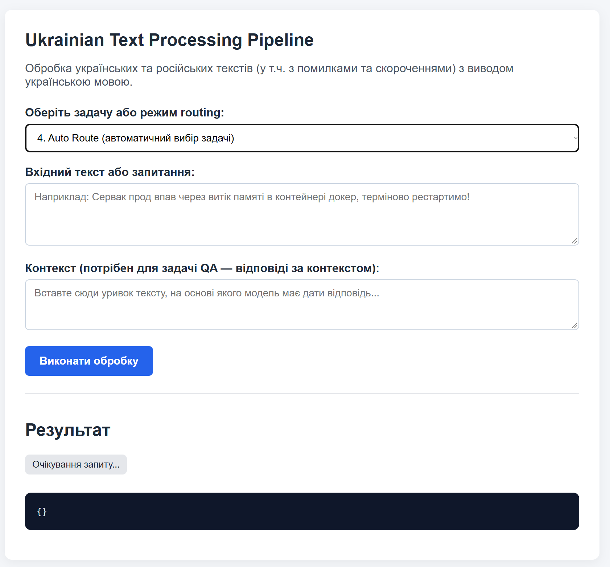
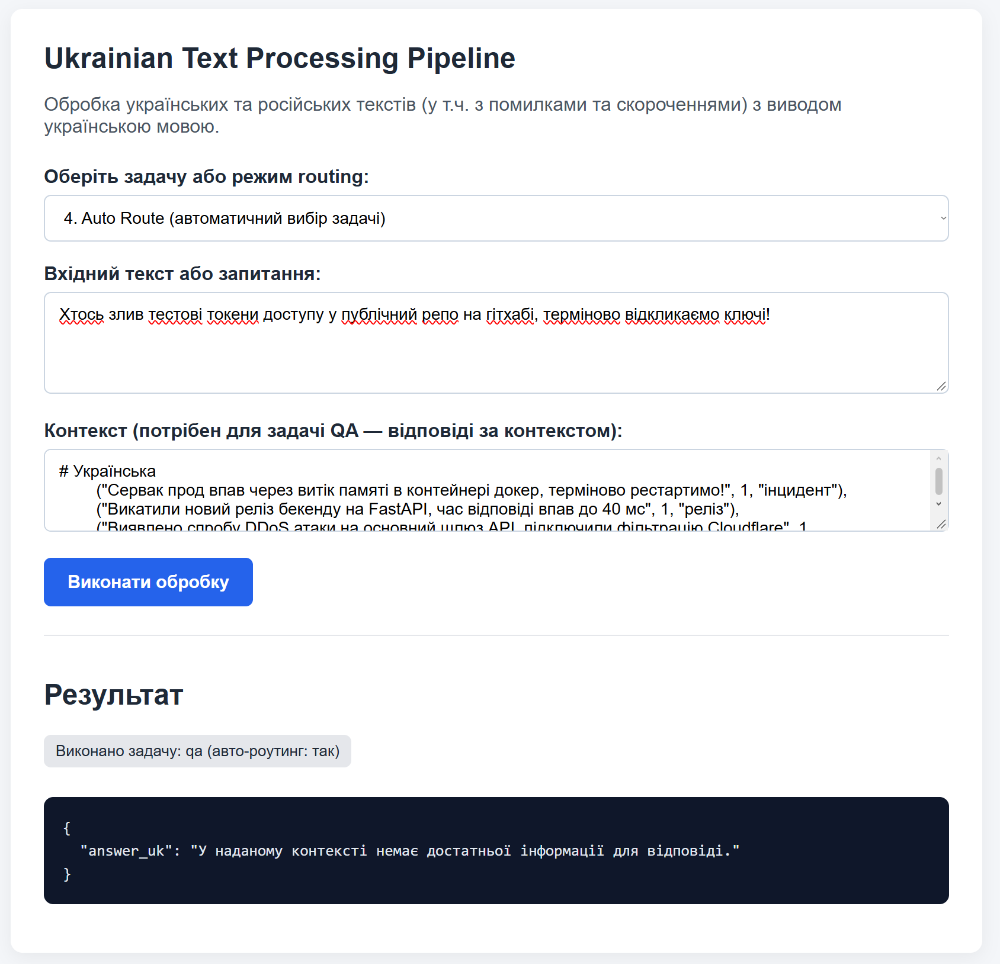
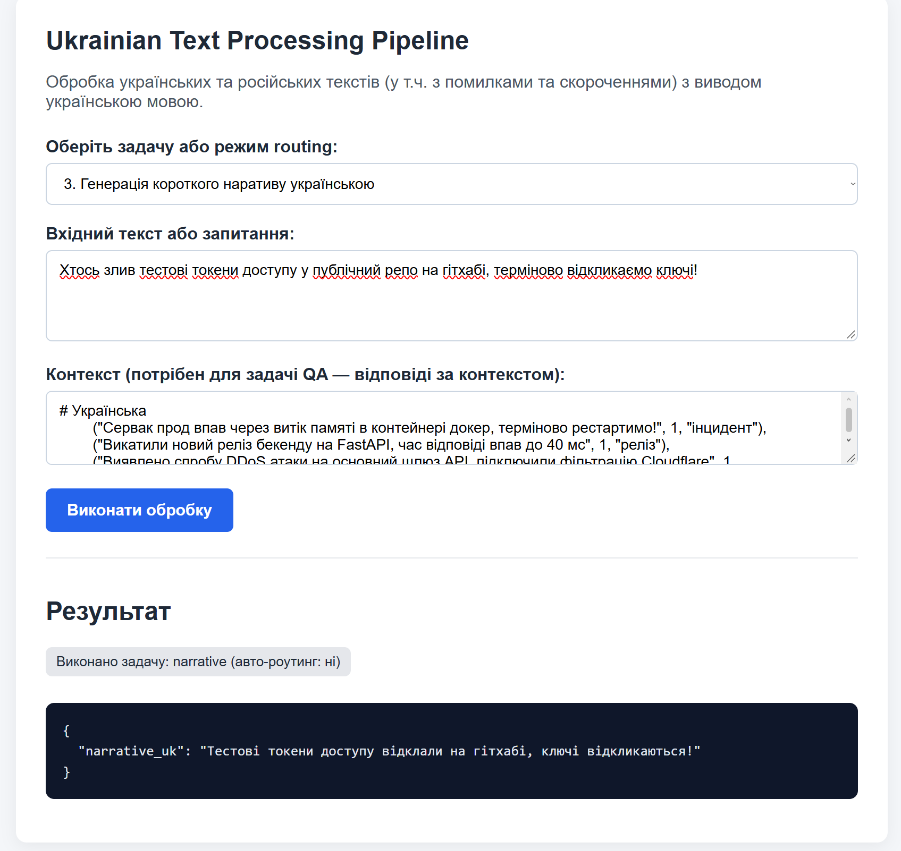

# 🇺🇦 Ukrainian Text Processing Pipeline (NLP & Transformers)

Навчально-практичний проєкт у межах портфоліо, присвячений обробці українських та російських текстів (зокрема зі скороченнями, опечатками та неформальною лексикою) з формуванням результатів українською мовою.

Проєкт реалізовано у **процедурному стилі** (звичайні функції `def`, без зайвих абстракцій і складних фреймворків), щоб кожен крок конвеєра був прозорим для читання, тестування та пояснення на технічній співбесіді.

---




## 🎯 Задачі пайплайну

1. **Бінарна класифікація релевантності** — визначення, чи стосується вхідний текст тематики IT, інфраструктури, розробки та кібербезпеки (`1` — релевантно, `0` — нерелевантний шум/побут/реклама).
2. **Класифікація подій + структурований JSON** — визначення категорії (`інцидент`, `кібератака`, `реліз`, `інше`), критичності (`severity`) та короткого опису українською мовою з перевіркою валідності JSON (`json.loads`).
3. **Генерація короткого наративу українською** — перетворення вхідного повідомлення (українською або російською мовою, з помилками чи сленгом) на стислий зв'язний текст українською.
4. **Routing запитів** — автоматичне визначення сценарію обробки (`auto_route` → `relevance`, `event_json`, `narrative` або `qa`) та виклик відповідної функції.
5. **Відповідь на запитання за контекстом (QA)** — формування відповіді українською мовою виключно на основі наданого користувачем уривку тексту без вигадування фактів.

---

## 🛠️ Технологічний стек

- **Мова:** Python 3.11+
- **Deep Learning & NLP:** PyTorch, HuggingFace Transformers (`distilbert-base-multilingual-cased`, `Qwen/Qwen2.5-1.5B-Instruct`)
- **Класичний ML та робота з даними:** Scikit-learn (`TfidfVectorizer`, `LogisticRegression`, `train_test_split`, метрики), Pandas, Joblib
- **Веб-інтерфейс та API:** FastAPI, Uvicorn + простий фронтенд на чистому HTML, CSS та JavaScript (`static/`)

---

## 📂 Структура проєкту

```text
02_ukrainian_nlp_pipeline/
├── README.md                    # Опис проєкту, результати експериментів та інструкція запуску
├── data/                        # Згенерований датасет: train.csv (56), val.csv (12), test.csv (12)
├── saved_models/                # Збережені артефакти (baseline_model.joblib та distilbert_relevance/)
├── static/                      # Простий веб-інтерфейс без фреймворків
│   ├── index.html
│   ├── style.css
│   └── script.js
└── src/                         # Процедурні модулі конвеєра
    ├── __init__.py
    ├── dataset_prep.py          # Очищення текстів та поділ вибірки на train / validation / test
    ├── train_classifiers.py     # Навчання та порівняння Baseline vs DistilBERT (PyTorch)
    ├── prompt_experiments.py    # Порівняння варіантів промптів та перевірка валідності JSON
    ├── nlp_pipeline.py         # Єдина точка входу для всіх 5 задач і routing
    └── api_app.py              # FastAPI сервер (/ та POST /api/process)
```

---

## 📊 Датасет та його обмеження

- **Джерело даних:** у проєкті використано невеликий синтетичний датасет (80 прикладів сумарно: по 40 релевантних IT-повідомлень та 40 нерелевантних повідомлень українською й російською мовами), сформований для навчально-експериментальних цілей.
- **Поділ вибірки:** стратифікований поділ у пропорції 70% / 15% / 15% (`train` = 56, `validation` = 12, `test` = 12), щоб частка класів зберігалася в усіх частинах.
- **Попередня обробка:** видалення URL-посилань, нормалізація пробілів (`clean_input_text`), токенізація з падінгом і обрізанням (`padding=True`, `truncation=True`, `max_length=128`).

### Обмеження синтетичних даних

Через компактний розмір і синтетичне походження датасет не охоплює всі реальні діалекти, специфічні логи чи довгі тексти, а високі метрики на тестовій вибірці частково відображають близькість доменних формулювань.

Для реального production-сценарію датасет необхідно суттєво розширити реальними розміченими прикладами та провести додаткову валідацію.

---

## 🧪 Результати навчання та порівняння моделей

### 1. Бінарна класифікація: Baseline (TF-IDF + LogisticRegression) vs DistilBERT

Навчання `distilbert-base-multilingual-cased` виконувалося протягом 4 епох на CPU (AdamW, `lr=3e-5`, `batch_size=8`).

Втрати на навчальній вибірці знизилися з `0.6925` до `0.0982`, а на валідаційній — з `0.6362` до `0.0593`.

| Модель | Accuracy | Precision | Recall | F1-score | Час навчання (сек) |
|---|---:|---:|---:|---:|---:|
| Baseline (TF-IDF + LogReg) | 0.7500 | 0.8000 | 0.6667 | 0.7273 | 0.016 |
| Transformer (DistilBERT) | 0.9167 | 0.8571 | 1.0000 | 0.9231 | 73.220 |

**Висновки:**

- TF-IDF + LogisticRegression працює миттєво (0.016 сек), але гірше вловлює семантику при перефразуваннях або опечатках (Recall = 0.6667).
- Донавчений DistilBERT значно краще узагальнює контекст та підвищує F1-score до 0.9231 (при повному покритті релевантних прикладів Recall = 1.0000 на тестовому наборі), хоча потребує більше ресурсів і часу на навчання та інференс.

### 2. Експерименти з промптами (Prompt Engineering для JSON-подій)

Було протестовано три варіанти промптів на `Qwen/Qwen2.5-1.5B-Instruct` (`temperature=0.1`).

| Варіант промпту | Валідних JSON | Спостереження щодо якості |
|---|---:|---|
| `zero_shot` | 2/3 (66.7%) | Іноді порушує формат JSON, змішує мови або не дотримується заданого списку значень. |
| `strict_schema` | 3/3 (100.0%) | Стабільно повертає валідний JSON, але на неоднозначних прикладах може помилятися у виборі категорії. |
| `few_shot` | 3/3 (100.0%) | Стабільний валідний JSON і краща точність визначення категорії (реліз vs інцидент) завдяки прикладам у промпті. |

---

## 💡 Приклади роботи пайплайну

### Приклад 1: Релевантне повідомлення українською

**Вхідний текст:**

> Сервак прод впав через витік памяті в контейнері докер, терміново рестартимо!

**Задача 1 — Релевантність:**

```json
{
  "is_relevant": true,
  "label": 1
}
```

**Задача 2 — JSON-подія:**

```json
{
  "category": "інцидент",
  "severity": "висока",
  "summary_uk": "Сервер прод впав через витік пам'яті у контейнері Docker, терміново рестартують."
}
```

### Приклад 2: Повідомлення російською

**Вхідний текст:**

> Выкатили обнову бэкенда, теперь API отвечает в два раза быстрее

**Задача 3 — Наратив українською:**

Короткий переказ українською про випуск оновлення бекенду та прискорення роботи API удвічі.

### Приклад 3: Нерелевантний побутовий текст

**Вхідний текст:**

> Продам гараж у центрі міста, сухой, є оглядова яма

**Задача 1 — Релевантність:**

```json
{
  "is_relevant": false,
  "label": 0
}
```

---

## 🚀 Інструкція запуску

Виконуйте команди з активованим віртуальним середовищем `.venv` із кореня репозиторію.

### 1. Підготовка датасету та навчання класифікаторів (Baseline vs DistilBERT)

```powershell
cd 02_ukrainian_nlp_pipeline/
python -m src.train_classifiers
```

### 2. Запуск порівняння промптів

```powershell
python -m src.prompt_experiments
```

### 3. Запуск веб-інтерфейсу та API на FastAPI

```powershell
uvicorn src.api_app:api_app --reload --port 8001
```

Після запуску відкрийте у браузері:

- Веб-інтерфейс: [http://127.0.0.1:8001](http://127.0.0.1:8001)
- Інтерактивна документація API: [http://127.0.0.1:8001/docs](http://127.0.0.1:8001/docs)
