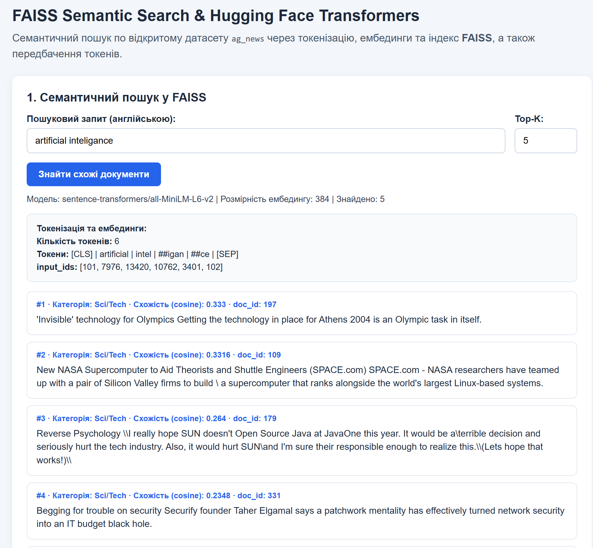
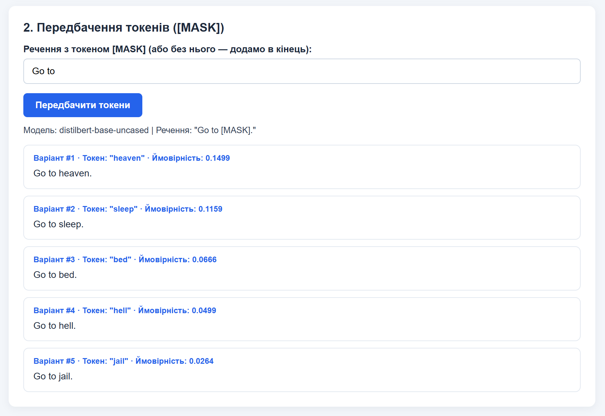

# 🔎 FAISS Semantic Search & Hugging Face Transformers

Третій проєкт у портфоліо, присвячений семантичному пошуку по відкритому датасету `ag_news` (новини англійською мовою) з використанням **Hugging Face Transformers**, **FAISS** та веб-інтерфейсу на **FastAPI** із простим фронтендом (`index.html`, `style.css`, `script.js`).

Проєкт реалізовано у **процедурному стилі** (звичайні функції `def`, без зайвих абстракцій і складних фреймворків).



---

## 🎯 Що реалізовано

1. **Побудова векторного індексу (`src/build_index.py`):**
   - Завантажує відкритий датасет `ag_news` (категорії *World, Sports, Business, Sci/Tech*) та формує піднабір документів у `data/documents.json`.
   - Виконує токенізацію (`AutoTokenizer`) та обчислює ембединги розмірності `384` через `AutoModel` (`sentence-transformers/all-MiniLM-L6-v2`) з урахуванням `attention_mask` (*mean pooling*) і L2-нормалізацією.
   - Створює та зберігає індекс `FAISS` (`IndexFlatIP` — внутрішній добуток нормалізованих векторів відповідає косинусній подібності) у `faiss_index/documents.index`.

2. **Семантичний пошук та передбачення токенів (`src/semantic_search.py`):**
   - Токенізує запит користувача, показує токени, `input_ids` та розмірність ембедингу, будує вектор запиту й знаходить `top_k` найближчих документів у FAISS.
   - Демонструє передбачення токенів для позиції `[MASK]` через `AutoModelForMaskedLM` (`distilbert-base-uncased`).

3. **FastAPI сервер та простий фронтенд (`src/api_app.py`, `static/`):**
   - Віддає сторінку з `static/index.html` і обробляє запити через `POST /api/search` та `POST /api/predict-tokens`.

---

## 📂 Структура проєкту

```text
03_faiss_semantic_search/
├── README.md                  # Документація проєкту та шпаргалка для співбесіди
├── data/                      # Збережені документи відкритого датасету (documents.json)
├── faiss_index/               # Збережений індекс FAISS (documents.index)
├── static/                     # Простий фронтенд без фреймворків
│   ├── index.html
│   ├── style.css
│   └── script.js
└── src/                        # Процедурні модулі
    ├── __init__.py
    ├── build_index.py          # Завантаження датасету, токенізація, ембединги та побудова індексу FAISS
    ├── semantic_search.py      # Токенізація запиту, пошук у FAISS та передбачення токенів ([MASK])
    └── api_app.py             # FastAPI сервер (/, POST /api/search, POST /api/predict-tokens)
```

---

## 🧪 Приклади роботи та спостереження

### 1. Токенізація субсловами (WordPiece)

Запит із помилкою `"artificial inteligance"` розбивається на:

```text
[CLS] | artificial | intel | ##igan | ##ce | [SEP]
```

- **Кількість токенів:** `6`
- **`input_ids`:** `[101, 7976, 13420, 10762, 3401, 102]`

Поділ на субслова (`##igan`, `##ce`) дозволяє частково зберігати семантику навіть при опечатках.

### 2. Семантичний пошук (`all-MiniLM-L6-v2` + `FAISS IndexFlatIP`)

При індексації 400 новин `ag_news` (розмірність вектора `384`) пошук повертає релевантні статті категорії `Sci/Tech` (наприклад, про суперкомп'ютер NASA, розробку на Java та мережеву безпеку).

Збільшення розміру вибірки (наприклад, до 2 000–5 000 записів) підвищує точність і показники косинусної подібності.

### 3. Передбачення токенів (`distilbert-base-uncased`)

Для речення:

```text
Check the [MASK].
```

Модель оцінює розподіл імовірностей по словнику та повертає контекстно доречні варіанти:

`clock`, `list`, `map`, `database`, `screen`.

---

## 🚀 Інструкція запуску

Виконуйте команди з активованим віртуальним середовищем `.venv` із кореня репозиторію.

### 1. Встановлення `faiss-cpu`

Якщо бібліотека ще не встановлена:

```powershell
pip install faiss-cpu
```

### 2. Побудова індексу FAISS

```powershell
cd 03_faiss_semantic_search
python -m src.build_index
```

### 3. Запуск FastAPI веб-сервера

```powershell
uvicorn src.api_app:api_app --reload --port 8002
```

Після запуску відкрийте у браузері:

- **Веб-інтерфейс:** [http://127.0.0.1:8002](http://127.0.0.1:8002)
